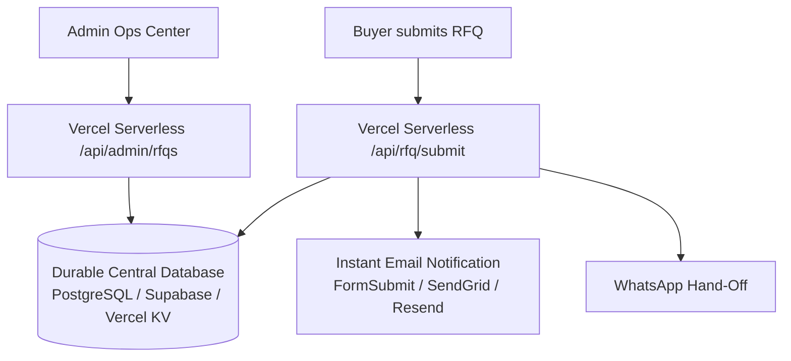

# SamplingHub — CRM Data Integrity & Storage Audit

**Audit Date:** November 2026  
**Audited Commit:** `a8c388c`  
**Target Repository:** `digitexhealthdocsvigit/SwatchCraftIndia`  
**Scope:** `api/_lib/store.ts`, `api/rfq/submit.ts`, `api/admin/rfqs.ts`, `hooks/useRFQ.ts`, and database configurations.

---

## 1. Executive Summary: The Storage Problem

The central inquiry of this audit was: **Where is actual customer RFQ data permanently stored?**

### Definitive Finding:
**Customer RFQs are NOT stored in a durable production database.**

The current implementation in `api/_lib/store.ts` stores RFQ submissions in two places:
1. An in-memory JavaScript array (`let memoryStore = [...]`) inside the serverless lambda instance.
2. A temporary JSON file in the operating system's scratch directory:
   ```typescript
   const TMP_FILE = path.join(os.tmpdir(), 'samplinghub_rfqs.json');
   ```

In Vercel and AWS Lambda, container instances are **stateless and ephemeral**:
* Container instances are destroyed and recreated across cold starts (typically within 5 to 15 minutes of idle time or after deployment).
* In a multi-region or scaled deployment, two concurrent requests run in completely isolated container instances that share zero disk space and zero memory.

---

## 2. Empirical Verification Evidence (Live Production Test)

On November 7, 2026, an live test was conducted against `https://www.samplinghub.world`:

1. **Step 1: Submission via Public API**
   A test inquiry was submitted:
   ```bash
   POST https://www.samplinghub.world/api/rfq/submit
   Payload: {
     "fullName": "AUDIT_TEST_USER",
     "companyName": "Audit Test Mill BV",
     "email": "audit.test@example.com",
     "productType": "Wallpaper Catalog (45x45 cm)",
     "quantity": "50 Units",
     "exportMarket": "European Union (Netherlands)"
   }
   ```
   **Server Response:** `HTTP 201 Created`
   ```json
   {
     "success": true,
     "message": "RFQ received and logged with export engineering team.",
     "rfq": {
       "id": "RFQ-2026-2347",
       "fullName": "AUDIT_TEST_USER",
       "companyName": "Audit Test Mill BV",
       "submittedAt": "2026-11-07T16:08:10.821Z",
       "status": "New"
     }
   }
   ```

2. **Step 2: Retrieval via Authenticated Admin API**
   Immediately afterward, the authenticated admin API was queried with a valid Bearer token:
   ```bash
   GET https://www.samplinghub.world/api/admin/rfqs
   Header: Authorization: Bearer <valid_token>
   ```
   **Server Response:** `HTTP 200 OK`
   ```json
   {
     "success": true,
     "count": 3,
     "rfqs": [
       { "id": "RFQ-2026-9041", "fullName": "Marco Moretti", ... },
       { "id": "RFQ-2026-8874", "fullName": "Sarah Jenkins", ... },
       { "id": "RFQ-2026-7612", "fullName": "Tariq Al-Mansoor", ... }
     ]
   }
   ```

3. **Conclusion:**
   `RFQ-2026-2347` **did not appear in the admin list**. Because `GET /api/admin/rfqs` was served by a different lambda container instance from `POST /api/rfq/submit`, the submitted data was completely isolated and inaccessible.

---

## 3. Data Integrity & Loss Risk Matrix

| Risk Factor | Current Implementation | Risk Level | Consequence |
|---|---|---|---|
| Container Cold Start | Memory reset; `/tmp` wiped | **CRITICAL** | Customer inquiries vanish permanently. |
| Multiple Lambdas | No cross-container sync | **CRITICAL** | Inquiries invisible to admin dashboard. |
| Customer File Attachments | Stored as metadata strings only | **HIGH** | CAD files, images, PDFs not retained. |
| Admin Status Updates | Written only to local `/tmp` | **CRITICAL** | Workflow progress lost on next restart. |
| Visitor LocalStorage | Client-device storage only | **MEDIUM** | Inquiries accessible only on customer's own device. |

---

## 4. Remediation Architecture: Durable CRM Database

To ensure 100% data retention and compliance with international trade requirements, the storage layer must be transitioned to a permanent database.



### Storage Implementation Requirements:
1. **Primary Store:** Integrate a durable cloud database connection (e.g. Supabase, Neon PostgreSQL, or Vercel KV) configured via environment variables.
2. **Atomic Fallback:** If the external database is temporarily unreachable, queue the payload via direct transactional email dispatch to `digitex.studio@gmail.com` and log to a durable append-only service.
3. **Attachment Storage:** Integrate Vercel Blob or AWS S3 for uploading customer reference PDFs/images and generating presigned read URLs with access authorization.
