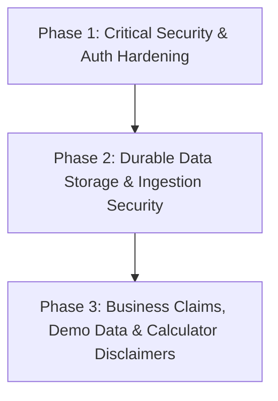

# SamplingHub — Prioritized Remediation Roadmap

**Target Repository:** `digitexhealthdocsvigit/SwatchCraftIndia`  
**Current Audit Branch:** `audit/phase2-post-deployment-acceptance`  
**Date:** November 2026  
**Auditor:** Antigravity Engineering  

---

## 1. Remediation Strategy Overview

Following the acceptance audit of commit `a8c388c`, critical security and data-persistence vulnerabilities must be resolved before proceeding to new feature work.

The remediation is organized into three controlled phases:

---

## 2. Phase 1: Critical Security & Authentication Hardening (Immediate)

### Tasks:
1. **Remove Client-Side Password Digest from `AdminLogin.tsx`:**
   - Delete `EXPECTED_CREDENTIAL_DIGEST` and all client-side hash calculations from `components/AdminLogin.tsx`.
   - The login form must send credentials exclusively to `/api/admin/login` and never contain credentials or hashes in bundle code.
2. **Implement Server-Side Route Guarding in `App.tsx`:**
   - Replace the raw `localStorage.getItem('samplinghub_admin_session') === 'true'` check with a live server validation call to `/api/admin/session`.
   - If the token is missing, invalid, or expired, reject access immediately and route the user to `/admin-login`.
3. **Eject Unauthenticated Sessions in `AdminDashboard.tsx`:**
   - If `/api/admin/rfqs` returns 401, immediately trigger `onLogout()`. Do not fall back to displaying mock data in an unauthenticated view.
4. **Timing-Safe Comparison in `api/_lib/auth.ts`:**
   - Replace string equality with `crypto.timingSafeEqual` for all HMAC and credential hash checks.
5. **Fail Secure on Missing Secrets:**
   - Ensure the serverless auth module rejects logins if `ADMIN_PASSWORD_HASH` or `ADMIN_SESSION_SECRET` is missing in production environment variables.

---

## 3. Phase 2: Durable Data Storage & Pipeline Integrity

### Tasks:
1. **Database Integration for RFQ Submissions:**
   - Replace `os.tmpdir()` in `api/_lib/store.ts` with a durable database connection (e.g. Supabase, PostgreSQL, or Vercel KV) using secure environment variables.
2. **Immediate Redundant Notification:**
   - Ensure every valid submission to `api/rfq/submit.ts` is concurrently dispatched via transactional email relay (e.g. to `digitex.studio@gmail.com`) with full structured JSON payloads so that inquiries are never lost even during external database maintenance.
3. **Attachment Preservation:**
   - Configure cloud object storage (e.g. Vercel Blob or AWS S3) for customer fabric reference files, CAD templates, and specification documents.

---

## 4. Phase 3: Business Claims, Demo Data & Calculator Disclaimers

### Tasks:
1. **Label Demonstration Data in `AdminDashboard.tsx`:**
   - Add explicit badges: `DEMO RECORD — PENDING BUSINESS VERIFICATION` to the 4 OEM partner units and 5 global buyer cards.
   - Provide an editable form so administrators can configure genuine partner facilities once agreements are finalized.
2. **Export Quotation Calculator Overhaul:**
   - Rebrand the pro-forma card to: **"Indicative Benchmark Estimate (Not a Confirmed Carrier Quotation)"**.
   - Add clear disclaimers stating that final pricing is subject to fabric weight verification, repeat inspection, carrier fuel surcharges, and destination country customs duties/VAT.
   - Add an editable Assumptions Register displaying base rates, assumed tare weight, and verification dates.
3. **Hero Statement Polish in `components/Hero.tsx`:**
   - Ensure the hero headline aligns 100% with the managed OEM solutions positioning without implying owned factory premises in Bhiwandi.

---

## 5. Implementation & Verification Rules

- All changes must be developed and verified on `audit/phase2-post-deployment-acceptance`.
- Production build (`npm run build`) must pass with 0 errors.
- Never push untested code to `main`.
- Prepare a clean pull request for review before merging.
